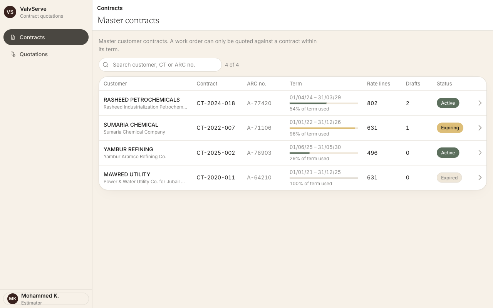
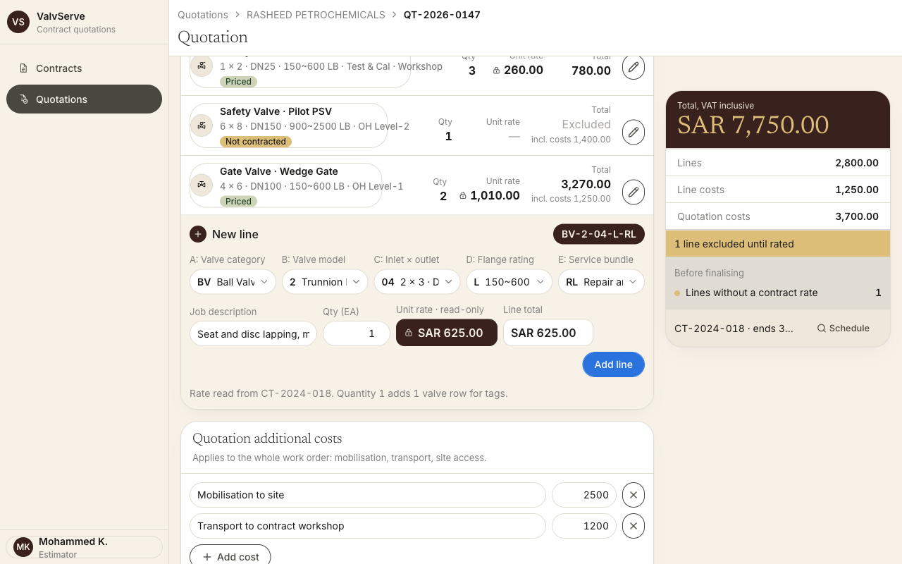
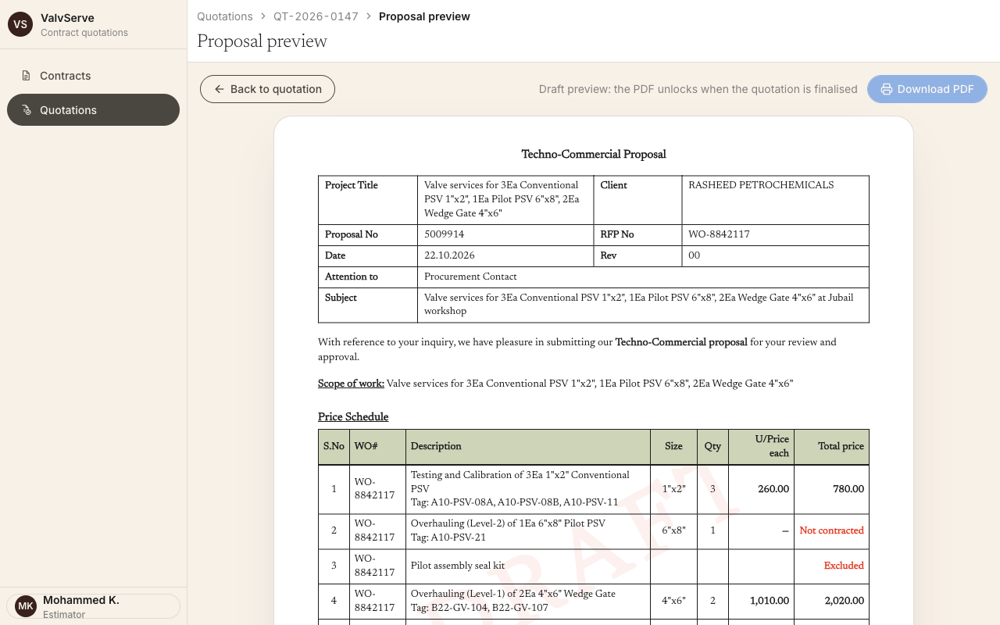

# Contract Quotation Portal — ValvServe

[](https://react.dev)
[](https://www.typescriptlang.org)
[](https://tailwindcss.com)
[](https://vite.dev)
[](https://qutation-saudi.vercel.app)

**Live demo → [https://qutation-saudi.vercel.app](https://qutation-saudi.vercel.app)**

An internal pricing tool for an industrial valve-services workshop in Jubail, Saudi Arabia. Estimators price maintenance work orders — testing, overhauling, repairs, spares — against **master contract rate schedules**, then issue the customer-facing **techno-commercial proposal** as a print-ready document.

The tool enforces one discipline: **the estimator never types a price.** Every rate is read, locked or flagged.

| Master contracts | Quotation composer | Proposal preview |
| --- | --- | --- |
| [](https://qutation-saudi.vercel.app) | [](https://qutation-saudi.vercel.app) | [](https://qutation-saudi.vercel.app) |

## The workflow it models

1. **Rates are contract-locked.** Each line price is a flat, VAT-inclusive SAR rate read from the master contract's schedule, keyed by a five-position identity — *Category · Model · Size · Rating · Service*. The composer resolves the rate as soon as all five positions are picked.
2. **"Not contracted" is flagged, never improvised.** A combination the schedule doesn't cover is marked on the line and raised in the admin **Rate queue** — one item per missing combination per contract. Publishing a rate there backfills every draft quotation waiting on it.
3. **Finalise is a gate.** A draft finalises only when every line carries a resolved rate and its valve tags are complete. Finalised quotations and their proposals become immutable.
4. **Contract term governs pricing; offer validity is the quotation's own clock.** The multi-year ARC term decides which rates apply (and drives Active / Expiring / Expired states); each quotation's validity — 30, 60 or 90 days — is independent of it.
5. **The proposal is a replica, not a redesign.** Preview renders the customer document on a white press sheet, and the PDF is produced through the browser's own print dialog — what you proof is what prints.

## Screens

| Screen | Role | What happens there |
| --- | --- | --- |
| Master contracts | all | The four master ARCs: rate-line counts, drafts in flight, term-usage bars |
| Contract detail | all | The rate schedule by rating band, plus the contract's boilerplate blocks |
| Quotations | all | Drafts, finalised and closed quotations, with open-rate-gap chips |
| Quotation composer | all | The five-position identity key resolves one locked rate per line; additional costs; summary; the finalise gate |
| Proposal preview | all | The press-sheet replica of the techno-commercial proposal |
| Rate queue | admin | Missing combinations across contracts; publish-to-backfill |
| Reference data | admin | The service catalog the schedule is built from |
| Audit log | admin | Who did what, when |
| Import rate sheet | admin | Load a new contract's rate schedule |

## Tech stack

| Layer | Choice |
| --- | --- |
| Build | Vite 8 (Rolldown), TypeScript 5.9 strict |
| UI | React 19, shadcn/ui (radix-nova) on Radix primitives, lucide-react via an SVG sprite |
| Styling | Tailwind CSS v4 (`@theme` tokens, CSS-first), class-variance-authority |
| Type | Newsreader (300, display serif) + Inter (body), self-hosted via Fontsource |
| Feedback | Sonner toasts |
| Hosting | Vercel (`vercel.json`: pinned framework, `npm ci`, immutable asset cache, security headers) |

## Architecture

```
src/
  domain/        pure business logic — no React
    pricing.ts     rate resolution, totals, term/validity dates, TODAY clock
    catalog.ts     the five-position identity key and lookups
    format.ts      SAR money, dates, DN size labels
    types.ts       Screen, QuoteStatus, line and contract types
  state/
    portal.tsx     one reducer store: screen router, role, quotations, queue
  screens/        nine screens (contracts → composer → preview; admin queue/ref/audit/import)
  components/
    app/           domain components: Shell, DataTable, IdentityKey, Money, Plate, StatusPill…
    ui/            shadcn primitives (generated; see patches below)
  config/          navigation map, status tone map
  data/            seeded demo catalog, contracts and quotations
  index.css        the "Field Notes" theme: tokens, base, control overrides
```

**Performance notes** (applied per Vercel's React best practices): the four screens a quotation always touches are static imports; the proposal preview and the admin screens are `React.lazy` chunks (Preview 9 kB, Import 10 kB, Rate queue 4 kB). Vendor 219 kB / main 237 kB (gzip ≈ 68 kB each). Derived figures are computed in the reducer, not in effects; lookup maps are built once at module level.

**Responsive:** the rail collapses to a navigation sheet below 60 rem, tables restack into cards, inputs grow to 44 px touch targets, and the line-item price cells drop to their own row on narrow screens.

**Design:** a warm-paper "field notes" system — cream canvas (`#f7f1e8`) with white reserved for elevated surfaces, a stone neutral doing the everyday work, one action blue (`#2a72de`) held strictly for the decisive CTA in each view, and earth accents (gold, clay, espresso, olive) for bands, chips and data. All tokens live in `src/index.css`.

## Getting started

```bash
npm install
npm run dev        # http://localhost:5173
```

| Script | What it does |
| --- | --- |
| `npm run dev` | Vite dev server |
| `npm run build` | `tsc --noEmit` then the production build to `dist/` |
| `npm run preview` | Serve the production build locally |
| `npm run typecheck` | TypeScript only |
| `npm run lint` / `lint:fix` | ESLint |
| `npm run format` / `format:check` | Prettier |

No secrets are required. [.env.example](.env.example) documents the one optional variable (`VITE_API_BASE_URL`) for a future API.

## Deployment

Deployed on Vercel. `vercel.json` pins the Vite framework, runs `npm ci` → `npm run build`, serves `dist/`, caches hashed assets immutably, and sets `X-Content-Type-Options`, `X-Frame-Options`, `Referrer-Policy` and `Permissions-Policy` headers.

## Assumptions

This is a **front-end demonstration of the workflow**, and the following are deliberate:

1. **The data is synthetic.** `src/data/seed.ts` ships a seeded catalog — four master contracts (2,560 rate lines combined) and quotations in draft, finalised and closed states — written to exercise every rule above. No real client data is included.
2. **There is no backend.** All state lives in a React reducer in memory; a reload resets the demo. The seed is the persistence layer for now.
3. **The demo clock is pinned.** `TODAY = '25/10/26'` in `domain/pricing.ts` drives term bars, expiring states and queue ages so the demo is reproducible; business dates are never derived from `Date.now()`.
4. **PDF means the browser print dialog.** No PDF library; the preview sheet carries dedicated print CSS. Exact pagination therefore varies slightly by browser.
5. **There is no sign-in.** The app opens directly as the Estimator; the account menu's "Switch to Admin (demo)" reveals the admin screens. Authentication is out of scope for the demo.
6. **Navigation is state, not URL.** There is no router; screens are a `Screen` union in the store, so there are no deep links.
7. **No automated tests.** Verification is `tsc --noEmit`, ESLint, the production build, and manual walkthroughs at 1280 px and 390 px.
8. **`noUncheckedIndexedAccess` stays off.** The seed tables and schedule lookups are guarded at the call sites that matter (rate resolution, totals); enabling it would ripple through the seed types without changing behaviour.
9. **Three one-class shadcn patches.** Generated `components/ui` files are kept pristine except: `transition-all` → `transition-colors` on button/badge/tabs (rule: never animate all), a `tracking-normal` on the dropdown-menu shortcut, and the dialog/sheet overlay tinted to the ink veil. The theme itself is imposed from `index.css` through unlayered `[data-slot]` overrides, so shadcn updates can't clobber it.
10. **Money is SAR and VAT-inclusive**, displayed exactly as the client's own contract forms present it; the proposal sheet keeps its own white document tokens (`--color-doc-*`) so the printed document stays white regardless of the app theme.

## Licence

[MIT](LICENSE)
